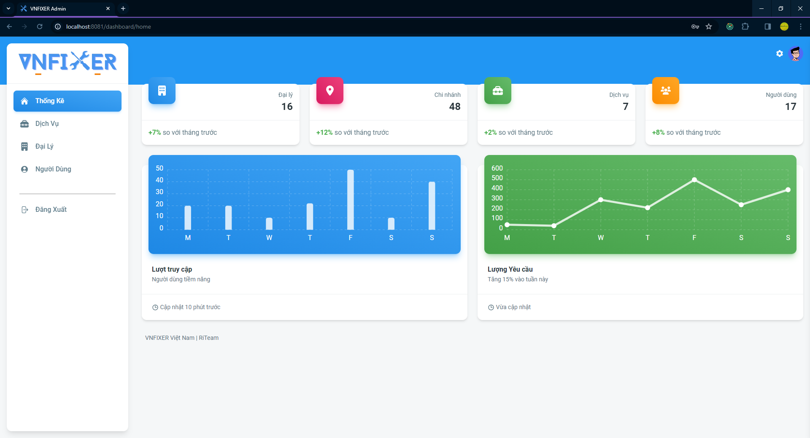
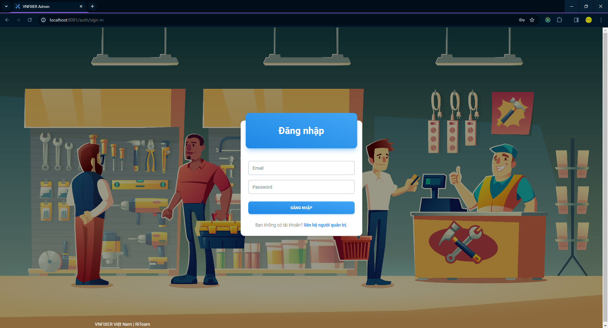
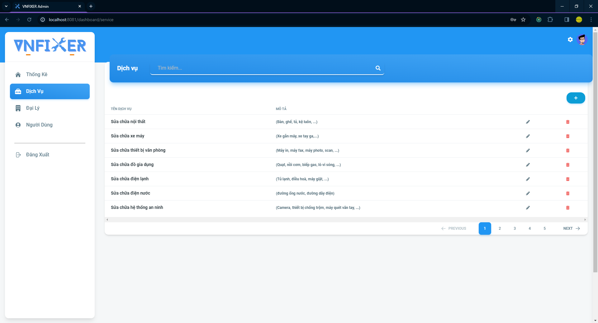
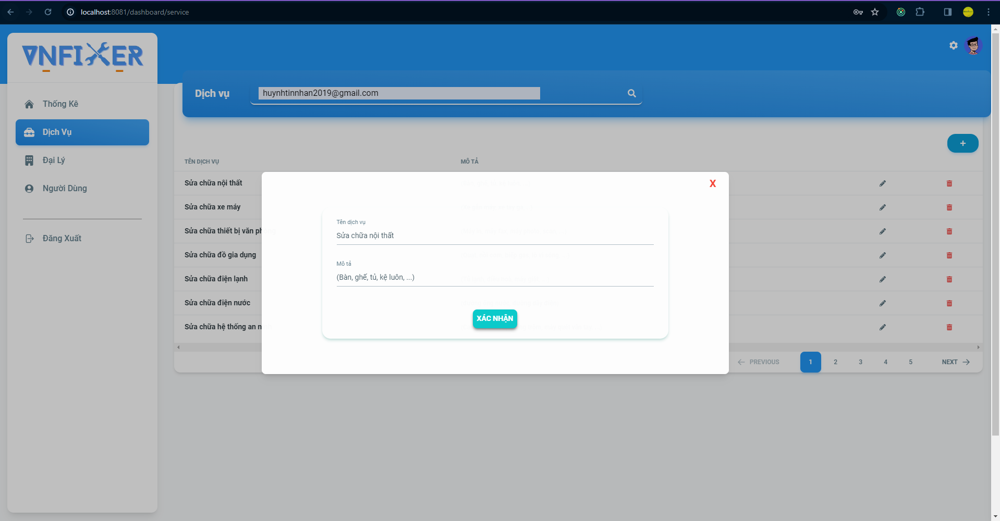
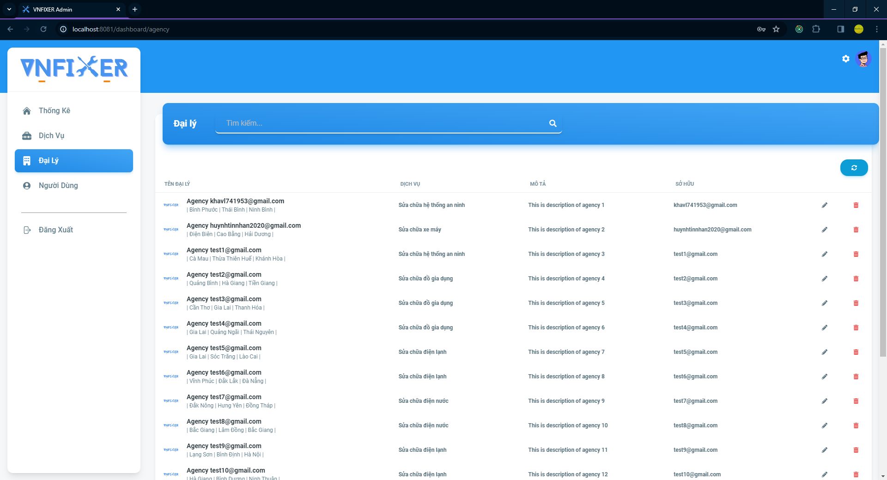
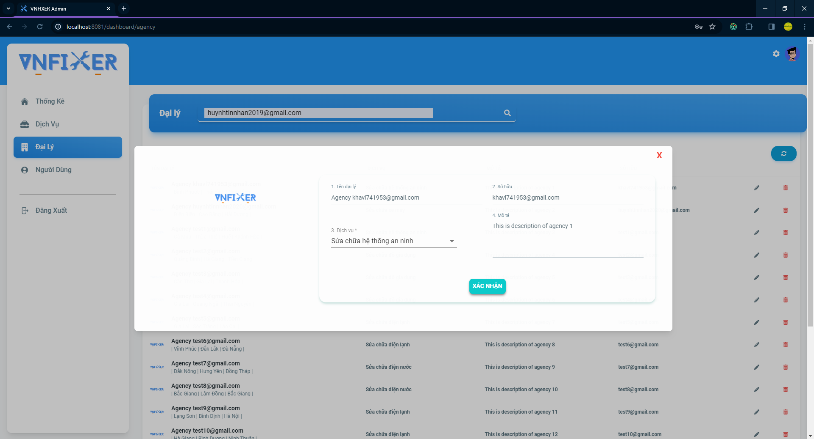
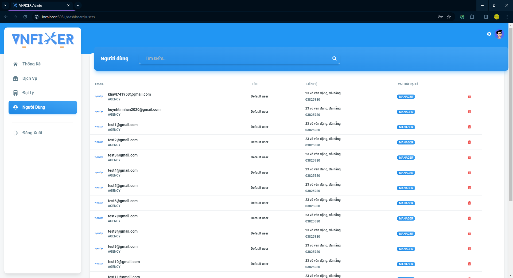

## VNFIXER Admin Web

# 💻How to run it

Clone it via the command line "git clone https://github.com/khasama/vnfixer-admin.git"

and

### `npm install`

then run

### `npm run dev`

Runs the app in the development mode.\
Open [http://localhost:8081](http://localhost:8081) to view it in your browser.

## 🌐Preview

# Dashboard page

# Auth page

# Category page

# Edit category

# Agency page

# Edit agency

# User page

## Demo

# `Updating...`
